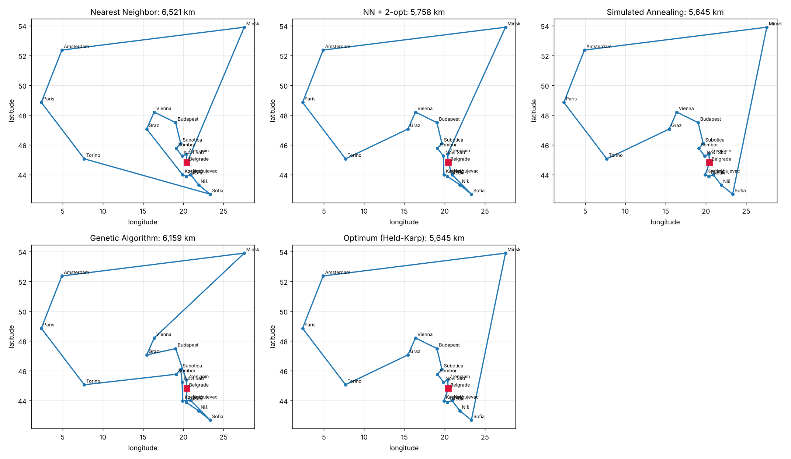

# TSP Heuristic Optimization

Four heuristics for the Traveling Salesman Problem, implemented from scratch and compared on 17 European cities. Every method is available both in **MATLAB** and in **Python**, and the Python version also computes the exact optimum, so you can see how far each heuristic is from the best possible route.



## Results

Start and finish in Belgrade, distances are great-circle kilometres (`python -m tsp`, seed 42):

| Method | Route length | Gap to optimum |
|---|---:|---:|
| Nearest Neighbor | 6,520 km | +15.5% |
| NN + 2-opt | 5,758 km | +2.0% |
| Simulated Annealing | 5,645 km | 0.0% |
| Genetic Algorithm | 6,159 km | +9.1% |
| **Optimum (Held-Karp)** | **5,645 km** | |

Simulated annealing finds the optimal tour. The genetic algorithm with pure swap mutation and no local search converges slowly, so it lands behind even the plain 2-opt result. Full routes are in [`results/results.csv`](results/results.csv); the MATLAB script writes the same comparison to `results/results_matlab.csv`.

## Methods

- **Nearest Neighbor**: greedy construction, always go to the closest unvisited city. O(n²).
- **2-opt**: starting from the NN tour, reverse route segments while that removes crossings and shortens the tour.
- **Simulated Annealing**: random 2-opt moves, accepting worse ones with probability e^(−Δ/T). T starts at 10% of the NN tour length and cools geometrically to 0.001 over 50,000 iterations.
- **Genetic Algorithm**: population 100, 300 generations, tournament selection (size 2), Order Crossover (OX), swap mutation (20%), elitism.
- **Held-Karp** (Python only): exact dynamic programming, O(2ⁿ·n²), practical up to about 18 cities.

## Usage

### Python

```bash
python -m venv .venv
source .venv/bin/activate        # Windows: .venv\Scripts\activate
pip install -r requirements.txt

python -m tsp                    # writes results/results.csv and results/routes.png
python -m tsp --seed 7 --no-plot
pytest                           # tests
```

### MATLAB

```matlab
run('matlab/tsp_heuristics.m')
```

Works from any folder (R2016b or newer). It reads `data/cities.csv`, plots one figure per heuristic and writes `results/results_matlab.csv`.

### Changing the cities

Edit `data/cities.txt` (one "City, Country" per line), then refresh the coordinates with OpenStreetMap:

```bash
python scripts/geocode.py        # rewrites data/cities.csv
```

The repo already ships `data/cities.csv`, so this step is only needed when the list changes.

## Project structure

```
data/cities.txt          city list (input for geocoding)
data/cities.csv          City, Lon, Lat
tsp/                     Python package: geo.py, heuristics.py, plot.py, __main__.py
matlab/tsp_heuristics.m  MATLAB implementation
scripts/geocode.py       city names -> coordinates
tests/                   pytest tests
results/                 generated comparison and plots
```

## Author

**Danilo Lazović**
- Student of Management and Organization - Operations Management
- Faculty of Organizational Sciences, University of Belgrade

## License

This project is available for educational and research purposes.
